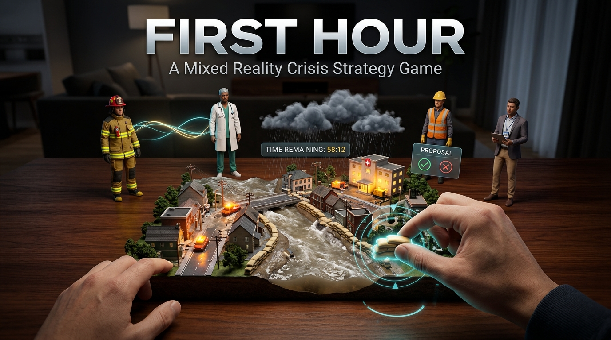
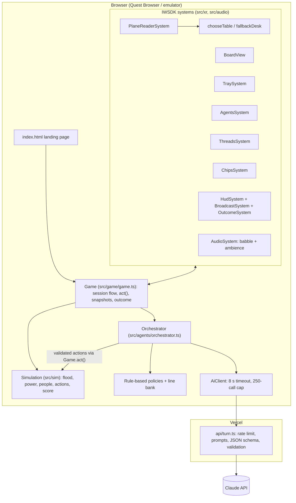
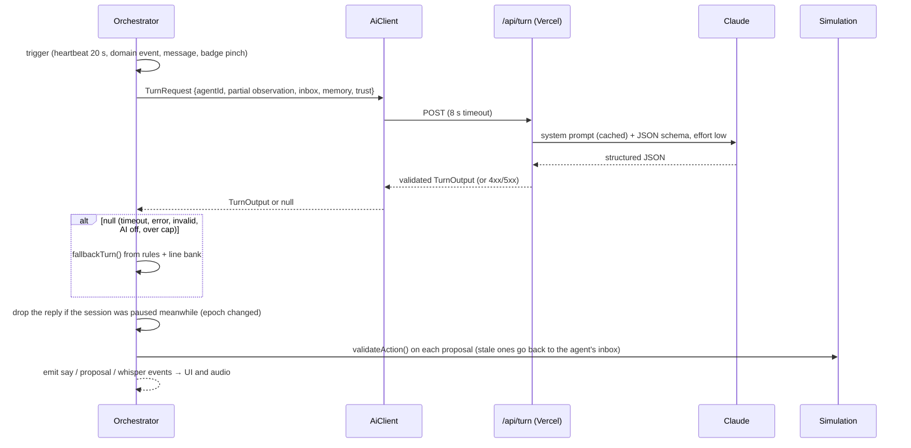

# First Hour

> A flood hits a town on your real table. Four AI department heads argue, whisper and act. You lead with your hands. Ten minutes.



**First Hour** is a seated, hands-only mixed-reality strategy game for Meta Quest and Meta VR Glasses, built with Meta's [Immersive Web SDK (IWSDK)](https://developers.meta.com/horizon/documentation/iwsdk/guides/overview/). It runs in the browser, so there's nothing to install.

- **Live build:** https://first-hour-phi.vercel.app (open it in the Meta Quest Browser, sit at a table, press **Start**)
- **Built for:** Meta VR Start Developer Competition 2026, Gaming track, New Experience division
- **Design doc:** [docs/superpowers/specs/2026-11-14-first-hour-design.md](docs/superpowers/specs/2026-11-14-first-hour-design.md)
- **Implementation plan:** [docs/superpowers/plans/2026-11-16-first-hour.md](docs/superpowers/plans/2026-11-16-first-hour.md)
- **Submission text and video shot list:** [docs/submission.md](docs/submission.md)


## What's new (17 Nov 2026)

| Feature | How it works |
|---|---|
| **Desktop judge mode** | Open the link on any desktop browser: the production build ships IWSDK's emulator (IWER) with a virtual conference room, so the full game runs with mouse and keyboard. Real Quest browsers are excluded by user agent and use native WebXR. |
| **Spoken agent voices** | The agent you face speaks aloud with the browser's speech synthesis, each with its own voice, pitch and rate. Everyone else murmurs in spatial babble, so you can hear where your attention is. Toggle on the landing page; falls back to babble if unsupported. |
| **Voice commands (optional)** | A mic button on the table: pinch, then say "approve", "deny the hospital", "Ravi, report", "broadcast", "pause", or any order ("Chief, send crews to Riverside"). Orders go into that agent's inbox and wake it up, so the AI responds to what you said. Every command also has a hand equivalent. |
| **Microgestures** | Thumb on the side of your index finger: **tap** approves the focused agent's proposal, **swipe left** denies it, **swipe forward** asks for a report. |
| **Agent Minds (X-ray view)** | Pinch the Minds lens: each agent shows its current intent, trust, mood, whether it is holding information back and what it remembers about you, and glowing links show which agents have been talking. |
| **Weather and event effects** | Rain over the board (heavier as the storm grows, with lightning on Director events), red pulsing danger cells, blinking beacons on deployed crews, and a floating banner for each event. |
| **Recenter** | A button beside the pause dial puts the board back in front of you. |
| **Daily challenge** | The same date-seeded flood for everyone today; your best rating for the day is saved. |
| **High-contrast captions** | Pure white text on black, larger type. |
| **AI, privacy and content disclosure** | On the landing page: AI-generated dialogue, fictional setting, no personal data, voice never stored, 10+. |

---

## Contents

1. [Why this exists](#1-why-this-exists)
2. [What you do in a session](#2-what-you-do-in-a-session)
3. [Controls (hands only)](#3-controls-hands-only)
4. [The agents](#4-the-agents)
5. [Core mechanics](#5-core-mechanics)
6. [Architecture](#6-architecture)
7. [The town simulation](#7-the-town-simulation)
8. [How the AI is used](#8-how-the-ai-is-used)
9. [Mixed reality, devices and comfort](#9-mixed-reality-devices-and-comfort)
10. [Getting started](#10-getting-started)
11. [Testing without a headset](#11-testing-without-a-headset)
12. [Configuration](#12-configuration)
13. [Deployment](#13-deployment)
14. [Automated tests](#14-automated-tests)
15. [Project structure](#15-project-structure)
16. [Tuning reference](#16-tuning-reference)
17. [Competition requirements checklist](#17-competition-requirements-checklist)
18. [Known limitations](#18-known-limitations)
19. [Roadmap](#19-roadmap)
20. [Credits and notes](#20-credits-and-notes)

---

## 1. Why this exists

In a disaster, the decisions made in the **first hour** are made by local officials who almost never practise them. Real practice drills, called *tabletop exercises*, need a trained facilitator and a room full of people playing the fire service, the hospital, utilities and the press. Because of the cost and coordination involved, most small towns, schools, hospitals and companies run them rarely or never.

First Hour replaces that room of role-players with AI agents. Each has its own goals, its own private information and its own opinion of you, and they sit around **your own table**. One person can run a realistic drill in ten minutes, and it plays as a game first.

**Why it has to be VR.** Five people arguing at once is unreadable on a flat screen. In VR:

- each agent has a place at the table and a voice that comes from that place, so you can follow who's talking;
- who you turn to *is* your decision about who gets your attention;
- handing someone a physical gold chip *is* delegation;
- the town sits on your real table, so the room changes the game.

---

## 2. What you do in a session

A session is **10 real minutes**, which is **one game hour** (1 real second = 6 game seconds), plus an optional debrief.

| Real time | What happens |
|---|---|
| 0:00 | Landing page: title, one-line pitch, **Start**, and an "AI agents on" toggle. Start begins an `immersive-ar` session (passthrough). |
| 0:00–0:03 | **Table finding.** The game looks for a detected horizontal surface labelled `table` or `desk` within reach. If none is found within 3 s, a **virtual desk** appears in front of you. |
| 0:03–0:05 | The town of **Harrow Bend** unfolds on the table like a pop-up book. Rain starts. Four agents rise along the far edge. |
| up to 1:30 | **Onboarding, taught by the agents, with no walls of text.** The Fire Chief asks you to pinch his badge. Utilities asks you to drop a sandbag on the Riverside bank. A scripted whisper teaches eavesdropping, and the Hospital Director explains the gold chips. **The crisis clock starts when your first sandbag lands**, or after 90 s. |
| 8 minutes | **Crisis.** The flood spreads. The Director agent releases events (bridge collapse, generator fault, a "dam burst" rumour). Agents propose, argue, whisper and act. |
| End | **"The first hour is over."** An outcome card shows people safe, hospital power uptime, rumours countered, team trust and a letter rating from A to E. |
| Optional | **Debrief.** Three key moments, each tied to a leadership principle. Pinch one and the board replays to that minute; a row of minute marks lets you scrub the whole hour. The panel also reveals the private deals you missed. Then **Play again** or **Exit**. |

The town remembers you. Damage is repaired between sessions, a good rating unlocks an upgrade, the weather rotates, and agents carry a memory line about how you treated them last time ([§5.8](#58-coming-back-persistence)).

---

## 3. Controls (hands only)

You never need a controller: every action is a **pinch** or a fingertip **poke**. Pinch is the gesture with the most reliable hand tracking on Quest, and the only one the emulator copies from recorded Quest 3 hand data.

| Action | How | What it does |
|---|---|---|
| **Deploy a resource** | Pinch-grab a token from the tray at the near edge and release it over a cell | Sandbags raise a wall, crews rescue, buses evacuate, the pump drains, the fuel truck refuels the hospital. A rejected drop (for example a bus in the river) glides back to the tray. |
| **Recall a resource** | Grab a deployed token and release it off the board | Returns it to the tray |
| **Ask for a report** | Pinch or poke an agent's gold **badge** | The agent takes a turn now and tells you what they know (if they trust you) |
| **Approve or deny** | Pinch **✓** or **✗** on the proposal card above an agent | Approve applies the action (+5 trust); deny refuses it (−3 trust). Unanswered cards expire after 15 s. |
| **Eavesdrop** | Pinch the bead in the middle of a glowing **whisper thread** | Reveals a private message between two agents. Both notice: −5 trust each. |
| **Delegate** | Grab a **gold chip** and release it at an agent's feet | That agent's proposals now go ahead automatically (+10 trust). Grab the chip back to take authority away (−8 trust). |
| **Broadcast** | Pinch the purple **Broadcast** card, then pick one of three messages | Raises public compliance with evacuations and counters the top rumour. Recharges in 30 s. |
| **Pause** | Poke the **Pause** dial on the near-right corner | Freezes everything. Taking the headset off or opening the system menu also pauses. |
| **Attention** | Just turn your head | The agent you face shows full captions and speaks louder. Others murmur. |

Everything sits within about 0.3–0.7 m of a seated player, inside a two-foot radius.

---

## 4. The agents

### 4.1 The four department heads (at the table)

Each is a separate agent with its own private view of the town, its own goals, trust and memory. They are fictional.

| Agent | Wants | Personality | Private information only they see | Can do |
|---|---|---|---|---|
| **Chief Okafor**, Fire Chief | Crews on rescues now; sandbags where people live | Impulsive, brave, blunt | Rescue calls per district, crew status | Deploy crews and sandbags |
| **Dr. Lindqvist**, Hospital Director | Power and fuel priority for 14 patients on life support | Cautious, precise, stubborn about patient safety | Generator fuel, grid status at the hospital | Deploy the fuel truck |
| **Ravi Menon**, Utilities & Roads Lead | Cut power to flooded homes; protect the substation | Methodical, dry, thinks in failure chains | Substation water level, bridge sensor, roads under water | Deploy the pump and sandbags; cut or restore district power |
| **Mara Quist**, Press & Public Officer | Get a clear public message out; kill rumours early | Quick, persuasive, anxious about public trust | The rumour feed, district compliance, call volume | Propose broadcasts; draft broadcast options |

They also **message each other**. A private message appears as a glowing whisper thread you may or may not catch.

### 4.2 The three agents behind the scenes

| Agent | Job | Limits |
|---|---|---|
| **Director** | Paces the crisis by choosing events from a fixed deck: `bridge_collapse`, `generator_fault`, `bus_stranded`, `rumour_dam`, `rain_surge`, `substation_alarm`, `viral_livestream` | Never before 90 s into the crisis, at most one event per 60 s, never repeats an event, and can only pick from the deck. Fallback schedule: 180 s, 300 s, 390 s, 450 s. |
| **Rumor** | Writes one short, believable but false rumour tied to the current flood state | From 30 s, at most one per 45 s. Lowers a district's evacuation compliance. Only the Press Officer can see rumours. |
| **Debrief** | Writes the after-action review: three key moments, each with a principle and second-person feedback | Principles: clear objectives, span of control, delegation, checking information, one public message |

### 4.3 What makes it genuinely multi-agent (and not a chatbot)

- **Separate, partial views of the world.** [`src/agents/observe.ts`](src/agents/observe.ts) builds a different view for each agent. The Hospital Director never sees the rumour feed; the Fire Chief never sees generator fuel.
- **Actions, not just words.** An agent returns structured actions (`deploy`, `recall`, `cut_power`, `restore_power`, `broadcast`, `report`). The simulation checks every action against the current state and the agent's role before anything happens.
- **Agent-to-agent communication.** Messages go into other agents' inboxes and wake them up, so agents coordinate, disagree and go around you.
- **Memory and trust.** Agents remember notes from this session and up to three lines from past sessions. Trust drives tone, whether an agent shares or withholds information, and how it behaves when ignored.
- **The game still works with the AI removed.** Every agent has a rule-based fallback with a bank of scripted lines. If the model is off, slow, over budget or returns something invalid, that turn falls back silently. The competition's "remove the third-party service" test passes: what remains is a complete game.

---

## 5. Core mechanics

### 5.1 Attention is the resource (span of control)

Each frame, the agent closest to your head direction within a **20° cone** is *focused* ([`src/game/attention.ts`](src/game/attention.ts)). Being unfocused has consequences:

| Unattended for | Consequence |
|---|---|
| any time | Captions shrink to a short preview, and their babble drops 12 dB |
| > 45 s (and no chip) | The agent **freelances**: it may deploy one of its own resources by its own judgment, once per 45 s window, logged for the debrief |
| > 60 s | Trust −2 every 30 s |
| > 90 s | Logged as "left unattended" for the debrief |

On Quest 3, head direction stands in for gaze. On Meta VR Glasses, IWSDK's real eye tracking will drive the same mechanic.

### 5.2 Trust

Each agent's trust runs from 0 to 100 and starts at 60 ([`src/agents/trust.ts`](src/agents/trust.ts)).

| Event | Change |
|---|---|
| You approve their proposal | +5 |
| You deny it | −3 |
| Ignored for more than 60 s | −2 per 30 s |
| You eavesdrop on them | −5 |
| You give them a chip | +10 |
| You take the chip back | −8 |

Below **30**, an agent may withhold its private information and coordinate with others without you.

### 5.3 Proposals and delegation

- Each agent keeps at most one live proposal per action type; a newer one replaces the older.
- A proposal expires after **15 s**. If the agent holds a gold chip, it goes ahead automatically instead.
- Every proposal is re-checked when it arrives *and* again when it is applied, because an AI reply can arrive up to 8 s late.

### 5.4 Whispers

A private message becomes a pulsing arc between two agents for **8 s**. Pinch its bead to read it. Unheard whispers are logged and revealed in the debrief.

### 5.5 Broadcasts and rumours

- **Rumours** lower one district's compliance by 0.1 × severity, which slows bus evacuations there.
- **A broadcast** raises every district's compliance by 0.15. If it counters a specific rumour, that district gains another 0.2.
- The broadcast card shows three ready-made messages instantly. The first always counters the most severe open rumour. When the Press Officer's own drafts arrive, they replace the ready-made ones.

### 5.6 Director events

| Event | Effect |
|---|---|
| `bridge_collapse` | The bridge is gone; buses must find another route or are stranded |
| `generator_fault` | Hospital generator fuel drops to at most 8 minutes |
| `bus_stranded` | A deployed bus returns to the tray |
| `rumour_dam` | A severity-3 "the dam has burst" rumour in Oldtown |
| `rain_surge` | Rain intensity +0.4 for the rest of the hour |
| `substation_alarm` | +0.3 water at the substation |
| `viral_livestream` | A severity-2 rumour in Riverside |

### 5.7 Scoring and the debrief

[`src/sim/score.ts`](src/sim/score.ts) scores the hour:

- **People safe %**: everyone not harmed and not currently in danger.
- **Hospital uptime %**: the share of game time the hospital had power.
- **Rumours countered.**
- **Combined score** = 0.6 × safe% + 0.3 × uptime% + 10 × (share of rumours countered). The rating is **A** at 90 or above, **B** at 80, **C** at 65, **D** at 50, otherwise **E**.

The **debrief** ([`src/agents/debrief.ts`](src/agents/debrief.ts)) asks the Debrief agent for three moments. If that fails, a rule-based reviewer looks for:

- an agent left unattended;
- a chip given to a low-trust agent;
- freelancing;
- the substation outage;
- people left waiting;
- unanswered rumours;
- too many conflicting broadcasts.

It prefers three *different* principles. Missed whispers always come straight from the event log. The scrubber shows **snapshots taken every 10 s**, so the replay matches exactly what happened, including Director and Rumor events.

### 5.8 Coming back (persistence)

Progress is saved in the browser's `localStorage` (key `fh.save`), with no accounts ([`src/game/persist.ts`](src/game/persist.ts), [`src/game/progress.ts`](src/game/progress.ts)).

- **Sessions played and best rating.**
- **Upgrades:** a rating of A or B unlocks the next one, in this order:
  1. **Levee:** permanent sandbags on two Riverside bank cells.
  2. **Backup generator:** 90 minutes of fuel instead of 60.
  3. **Second bus:** a third bus token.
- **Agent memories:** up to 3 lines per agent, such as "You left me hanging last time."
- **Weather rotation:** heavy rain, then night, then light.

If storage is unavailable (private browsing, cleared data), the game runs as a first session.

---

## 6. Architecture

### 6.1 Layers



**Rules that hold the design together:**

- **The simulation is the single source of truth.** It's pure TypeScript with no DOM or rendering, is deterministic for a given seed, and is fully unit-tested.
- **Every change to the town goes through `Game.act()`** → `applyAction()`, which checks it, logs it and records it.
- **The AI never touches state directly.** It proposes; the simulation decides.
- **Rendering reads from the simulation.** `BoardView.syncFrom()` updates instanced meshes only when the simulation has changed.

### 6.2 One agent turn



### 6.3 Turn scheduling and cost control

| Rule | Value |
|---|---|
| Heartbeat (every agent takes a turn at least this often) | 20 s, staggered 3 s apart |
| Minimum gap for turns woken by events or messages | 6 s per agent |
| Requests in flight per agent | at most 1 |
| Client timeout | 8 s, then the scripted fallback |
| AI calls per session | 250 maximum, then scripted for the rest of the session |
| Server rate limit | 60 requests per minute per IP (best effort, in memory) |
| Pause handling | Every pause increments `session.epoch`; replies tagged with an older epoch are dropped |

---

## 7. The town simulation

### 7.1 The map: Harrow Bend (12 × 8)

```
x →        0 1 2 3 4 5 6 7 8 9 10 11
y=0  north  r r S = = = r r r p r r     hillcrest (x0-5) / eastfield (x6-11), elevation 5
y=1         r = = + = = = F = r r r     elevation 4   (+ hospital, F fire station)
y=2         B B B B B B = B B B B B     riverbank, elevation 1 (road at x6)
y=3         R R R R R R H R R R R R     river, elevation 0 (H = bridge)
y=4         R R R R R R H R R R R R
y=5         B B B B B B = B B B B B     riverbank, elevation 1
y=6         r r = = = = = = = = = r     main street, elevation 1
y=7  south  r r r r r r r r P r r r     riverside (x0-5, elev 1), oldtown (x6-7, elev 2), market (x8-11, elev 2; P substation elev 1)
```

`S` is Hillcrest school, the shelter on high ground. Each residential cell starts with 40 residents, about 1,000 people in total.

### 7.2 Systems (each runs every 0.5 real seconds = 3 game seconds)

| System | File | Model |
|---|---|---|
| **Flood** | [`src/sim/flood.ts`](src/sim/flood.ts) | River cells gain `rain × 0.0013` per game second. Each cell moves part of its height difference (water + elevation) to lower neighbours. Sandbags raise a cell's wall by 1 per stack. The pump drains its cell and neighbours at 0.004 per game second. |
| **Power** | [`src/sim/power.ts`](src/sim/power.ts) | The substation floods above 0.5 water, which cuts power everywhere. Districts the Utilities Lead cuts lose power. The hospital runs on a generator (60 game minutes of fuel; the fuel truck refills it). A flooded cell that still has power logs a live-water hazard once. |
| **People** | [`src/sim/people.ts`](src/sim/people.ts) | Residents in water deeper than 0.3 are *in danger*. After 900 game seconds unrescued they count as harmed (a score only; never shown). A crew on a cell rescues it after 120 game seconds. Buses move people to the school at `0.2 × compliance / (1 + path length / 10)` people per game second. Routes use roads, the bridge (if intact) and the bus's own district's streets. |
| **Actions** | [`src/sim/actions.ts`](src/sim/actions.ts) | `validateAction` (a dry run) and `applyAction` check bounds, token state, river cells and role permissions. Each call adds exactly one log event. |
| **Engine** | [`src/sim/engine.ts`](src/sim/engine.ts) | `createSim(seed, modifier, options)` and `tick()` (exact 0.5 s steps for any frame rate, with leftover time carried over). `replay()` is used by the determinism tests. |

Rain follows a curve: it starts at 70% of the weather's base intensity and ramps up to 120% over the first game half-hour. On heavy rain, Riverside's homes are in danger by about 3 real minutes.

---

## 8. How the AI is used

| Item | Value |
|---|---|
| Endpoint | `POST /api/turn` ([`api/turn.ts`](api/turn.ts)), a Vercel serverless function |
| SDK | `@anthropic-ai/sdk`, `messages.create` |
| Model | Environment variable `AGENT_MODEL`, default **`claude-haiku-5-5`** (low cost, fast). Set it to `claude-opus-5-5` for sharper arguing, at a much higher cost. |
| Effort | `low` |
| Output | Structured JSON via `output_config.format = { type: "json_schema", schema }`. There is one schema each for agent turns, the Director, the Rumor agent and the Debrief agent ([`src/agents/prompts.ts`](src/agents/prompts.ts)). |
| Validation | Agent turns are re-checked with Zod on the server *and* the client ([`src/agents/types.ts`](src/agents/types.ts)). Word limits: speech ≤ 25 words, rationale ≤ 15, messages ≤ 20, memory note ≤ 15; at most 2 proposals and 2 messages per turn. |
| Prompt caching | The fixed system prompt (fictional town brief, role card, allowed actions, output rules) is marked `cache_control: ephemeral` |
| Safety and tone | Prompts require a 10+ tone ("in danger" or "safe", never hurt) and forbid real people, places, agencies and brands. A refusal returns 502, and the client falls back to the scripted turn. |
| Secrets | `ANTHROPIC_API_KEY` exists **only** as a Vercel environment variable. The browser never sees it. |
| Request size | Bodies over 24,000 characters are rejected (413) |

**Rough cost:** on Haiku 5.5, about **$0.10 per 10-minute session**. Set a monthly spend limit on the key in the Claude Console.

---

## 9. Mixed reality, devices and comfort

- **Table detection** ([`src/xr/planes.ts`](src/xr/planes.ts), [`src/xr/table.ts`](src/xr/table.ts)) reads IWSDK's `XRPlane` and bounded `XRMesh` entities:
  - It prefers surfaces labelled `table` or `desk`, then any horizontal surface 0.35–1.1 m above the floor (or 0.2–0.9 m below your head if the floor is unknown).
  - Reach is measured to the table's **nearest edge** (at most 1.2 m), so a long conference table works.
  - The board goes on the near part of the table and stays inside its edges.
- **Fallback:** if no table is found in 3 s, a virtual desk appears 0.45 m in front of you at 0.72 m height. In opaque VR it comes with a dim floor.
- **Board size:** fits the surface at 12:8 proportions, at most 0.9 × 0.6 m and at least 0.5 × 0.35 m. It faces you, with the token tray on your side.
- **Narrower field of view (Meta VR Glasses, about 74° × 68°):**
  - all four agents stand along the far edge, at about ±9° and ±27°;
  - the tray uses the central 70% of the near edge;
  - the dial, broadcast card and chips sit just inside the corners.
- **Seated comfort:** no movement around the room, nothing to stand for, everything within reach.
- **Clean pause and resume:** taking off the headset, opening the system menu or blurring the session pauses the simulation, the agents and the audio.
- **Audio** ([`src/audio`](src/audio)):
  - agents speak in procedural, made-up syllables placed in 3D at each figure, each with its own pitch and timbre, with captions carrying the meaning;
  - rain is filtered noise whose intensity follows the simulation;
  - short chimes mark events, rejected drops, placements and whispers;
  - no audio files are downloaded.

---

## 10. Getting started

### Prerequisites

- **Node.js** 20.19+, 22.12+ or 24+ (`.nvmrc` pins 22.12.0)
- **npm**
- A recent Chromium-based browser for the emulator. A Meta Quest 3/3S is optional.

### Install and run

```bash
npm install
npm run dev          # starts the IWSDK-managed dev server and opens a managed browser with the XR emulator
```

Other useful scripts:

```bash
npm run dev:status   # server status and the local/network URLs (open a network URL on a Quest on the same Wi-Fi)
npm run dev:down     # stop the managed dev server
npm run typecheck    # tsc --noEmit (run this before trusting a runtime test; IWSDK systems fail quietly on type errors)
npm test             # vitest run (135 tests)
npm run build        # production build to dist/
npm run preview      # serve the production build locally
```

> **The AI in local development:** `npm run dev` serves only the front end, so `/api/turn` returns 404 and every agent uses its scripted fallback, a fully playable game. To hear the AI agents, use a Vercel deployment (§13).

---

## 11. Testing without a headset

The IWSDK dev server includes **IWER**, a browser-based XR emulator, plus a synthetic-room add-on. The emulator is configured in [`iwsdk.config.json`](iwsdk.config.json):

```json
"dev": { "emulator": { "device": "metaQuest3", "environment": "conference_room" } }
```

- **Rooms:**
  - `conference_room` has a 1.2 × 3.2 m table at 0.74 m, and is the main room for testing and filming.
  - `sunlit_living_room` has a coffee table at about 0.44 m.
  - Any room without a table exercises the virtual-desk fallback.
- **Glasses view:** set `"device": "metaVRGlasses"` to preview the narrower field of view.
- **Hands:** switch the emulator's input mode to hands. Hold the left mouse button to pinch.
- **Scripted interaction (CLI):**

  ```bash
  npx @iwsdk/cli xr set-input-mode --input-json '{"mode":"hand"}'
  npx @iwsdk/cli xr list-targets   # named targets: Token_sand1, Badge_fire, PauseDial, BroadcastCard, Btn_approve#…, Outcome_*…
  npx @iwsdk/cli xr run-sequence --input-json '{"device":"hand-right","steps":[{"target":"Token_sand1","approach":{"distance":0.06},"pinch":{"value":1,"at":"arrival"}},{"position":{"x":-0.41,"y":0.76,"z":-1.29},"depart":{"distance":0.06}},{"pinch":0,"duration":0.2}]}'
  npx @iwsdk/cli browser logs      # app logs are prefixed [FH]
  ```

- **Fast-forward (development builds only):** press **F** in the page to toggle ×8 game speed. It is stripped from production builds.
- **Performance readout (development builds only):** two seconds after the board unfolds, the console logs `[FH] perf` with triangles, draw calls, textures and visible meshes grouped by owner.

---

## 12. Configuration

| Where | Key | Meaning |
|---|---|---|
| Vercel environment | `ANTHROPIC_API_KEY` | Required for live AI agents. Server only. |
| Vercel environment | `AGENT_MODEL` | Model ID, default `claude-haiku-5-5` |
| `iwsdk.config.json` | `world.xr.mode` | `ar` (passthrough mixed reality) |
| `iwsdk.config.json` | `world.xr.features` | `handTracking`, `anchors`, `planeDetection`, `meshDetection` |
| `iwsdk.config.json` | `world.features` | `grabbing: true`, `sceneUnderstanding: true`, `locomotion: false`, `physics: false` |
| `iwsdk.config.json` | `dev.emulator` | Emulated device and synthetic room (§11) |
| Browser `localStorage` | `fh.ai` | `"0"` turns AI agents off; anything else turns them on (the landing-page toggle) |
| Browser `localStorage` | `fh.save` | Saved progress (§5.8) |

---

## 13. Deployment

The judges' link must be a public **HTTPS** URL. WebXR requires a secure context.

### Vercel (used here: the game and the agent function in one deploy)

```bash
npx vercel link --scope <your-team>             # once
npx vercel env add AGENT_MODEL production       # e.g. claude-haiku-5-5
# Add ANTHROPIC_API_KEY for Production in the Vercel dashboard:
#   Project → Settings → Environment Variables
npx vercel deploy --prod
```

[`vercel.json`](vercel.json) builds with `npm run build` and serves `dist/`. Files in [`api/`](api) become serverless functions. **Changing an environment variable requires a redeploy.**

**Node ESM note:** Vercel runs functions as Node ES modules, so every relative import reachable from [`api/turn.ts`](api/turn.ts) (under `src/sim` and `src/agents`) uses an explicit `.js` extension. Without it you get `ERR_MODULE_NOT_FOUND`.

### GitHub Pages (front end only)

GitHub Pages can host `dist/`, but it can't run `api/turn.ts`, so agents would always use their scripted fallback. Use Vercel if you want the AI.

---

## 14. Automated tests

```bash
npm test
```

There are **135 tests in 20 files**, run with Vitest in a Node environment ([`vitest.config.ts`](vitest.config.ts)).

| Area | File | Tests | What's proven |
|---|---|---:|---|
| Map | `tests/sim/map.test.ts` | 5 | 12×8 grid, one of each facility, school on high ground, 800–1,500 residents |
| Flood | `tests/sim/flood.test.ts` | 5 | Spreads downhill, sandbags block, pump drains, rain raises the river, deterministic |
| Power | `tests/sim/power.test.ts` | 5 | Substation outage, generator drains only during an outage, refuelling, hospital dark time, cut districts produce no live-water hazard |
| People | `tests/sim/people.test.ts` | 5 | Danger threshold, harm after 900 s, crew rescue, compliance-scaled evacuation, route fails once the bridge is gone |
| Actions | `tests/sim/actions.test.ts` | 8 | Out of bounds, already deployed, wrong role, river cell, sandbag wall, power permissions, broadcast counters, one log event per call |
| Engine | `tests/sim/engine.test.ts` | 6 | Starting tokens, 600 real s → 3,600 game s, odd frame times, deterministic replay, scoring |
| Session | `tests/game/session.test.ts` | 6 | Phase order, onboarding auto-end at 90 s, crisis lasts 480 s, pause freezes time and bumps the epoch |
| Persistence | `tests/game/persist.test.ts` | 5 | Throwing, missing or corrupt storage; round trip; 3-memory cap |
| Progress | `tests/game/progress.test.ts` | 5 | Upgrades change the starting town, outcome recording, weather rotation, onboarding script order and length |
| Attention | `tests/game/attention.test.ts` | 3 | 20° focus cone, nearest-angle tie-break, nobody in view |
| Table finding | `tests/xr/table.test.ts` | 16 | Labels, coffee table, shelf rejected, floor/ceiling/vertical rejected, reach, nearest, no floor known, fallback desk, board size, long tables |
| Turn schema | `tests/agents/schema.test.ts` | 7 | Word limits, list limits, unknown action or recipient, junk input |
| Fallback | `tests/agents/fallback.test.ts` | 11 | Partial observations, trust clamping, ≥12 lines per agent per situation, valid output across 200 random states, withholding only below 30 trust, rescue proposals, no blackout for flooded banks |
| AI client | `tests/agents/aiClient.test.ts` | 9 | 200 / 500 / 429 / invalid JSON / schema failure / offline / 8 s timeout / 250-call cap / disabled |
| Orchestrator | `tests/agents/orchestrator.test.ts` | 12 | One request in flight, heartbeat, stale-epoch drop, stale action rejected, approve/deny trust, expiry versus chip auto-apply, freelancing, whispers, eavesdropping, fallback, paused, 6 s throttle |
| Director | `tests/agents/director.test.ts` | 8 | Not before 90 s, valid AI choice, off-deck event rejected, 60 s gap, no repeats, fallback schedule, event effects |
| Rumor | `tests/agents/rumor.test.ts` | 4 | Compliance drop, press-only visibility, 45 s gap, template fallback, default broadcast drafts |
| Debrief | `tests/agents/debrief.test.ts` | 8 | Detects each moment type, always exactly 3, missed whispers, valid AI output used, bad AI output falls back, principle variety |
| Server | `tests/api/turn.test.ts` | 6 | 400 on bad input, parsed JSON returned, `AGENT_MODEL` honoured, low effort with a JSON schema and no temperature, 502 on refusal or bad JSON, 429 rate limit |
| Smoke | `tests/smoke.test.ts` | 1 | The test runner works |

The 3D layer (`src/xr`, `src/audio`) was verified in the IWER emulator rather than by unit tests: placement, grabbing and dropping tokens, pause, badges, broadcast, the full fast-forwarded session, the debrief and the Glasses view.

---

## 15. Project structure

```
api/
  turn.ts                 Vercel function: one agent turn → Claude → validated JSON
src/
  index.ts                World.create, system registration, landing page wiring, dev speed key
  assets.ts, components.ts  IWSDK manifests (no authored assets; all geometry is procedural)
  sim/                    Pure, deterministic simulation (no DOM)
    types.ts  map.ts  rng.ts  flood.ts  power.ts  people.ts  actions.ts  engine.ts  score.ts  log.ts
  agents/                 Multi-agent layer (pure TS, shared with the server)
    types.ts       Zod schemas, AgentState, TurnRequest
    roles.ts       The four department heads
    observe.ts     Partial view of the town per agent
    trust.ts       Trust changes and memory
    lines.ts       Scripted line bank (4 agents × 6 situations × 12 lines)
    fallback.ts    Rule-based policy per agent
    aiClient.ts    fetch /api/turn with timeout and cost cap
    orchestrator.ts  Scheduling, inboxes, proposals, whispers, chips, freelancing, throttling
    director.ts  rumor.ts  debrief.ts   The behind-the-scenes agents
    prompts.ts     System prompts and JSON schemas (used by the server)
  game/
    game.ts        One play-through: session, sim, board, orchestrator, Director/Rumor timers, snapshots, outcome
    session.ts     Flow state machine (landing → finding → unfolding → onboarding → crisis → outcome → debrief) with pause epochs
    attention.ts   Focus cone
    persist.ts     Safe localStorage save and preferences
    progress.ts    Upgrades, weather rotation, outcome recording, onboarding script
  xr/                     IWSDK systems and views
    planes.ts  table.ts   Table detection and placement
    board.ts             Instanced town board, water, houses, sandbags, highlight, fallback desk
    tray.ts              Grabbable resource tokens
    agentsView.ts        Figures, badges, nameplates, captions, proposal cards, attention
    threads.ts  chips.ts  broadcast.ts  hud.ts  outcome.ts  label.ts  tags.ts
  audio/
    audioSystem.ts  babble.ts  ambient.ts
tests/                    Vitest suites mirroring src/
docs/
  superpowers/specs/      Design document
  superpowers/plans/      Implementation plan
  submission.md           Devpost text and demo video shot list
public/scenes/            Environment-only scene JSON (lighting)
iwsdk.config.json         IWSDK project settings (XR features, emulator room)
vercel.json  vitest.config.ts  vite.config.ts  tsconfig.json
```

The project also contains IWSDK's own agent guidance (`AGENTS.md`, `CLAUDE.md`, `.claude/`, `.agents/`, `.cursor/`, `.github/instructions/`), which describes the framework's conventions.

---

## 16. Tuning reference

| Constant | Value | File |
|---|---|---|
| Time scale | 1 real s = 6 game s; 0.5 s ticks | `src/sim/engine.ts` |
| Onboarding maximum / crisis length | 90 s / 480 s | `src/game/session.ts` |
| Table search | 3 s | `src/game/game.ts` |
| Rain rate / flow / pump | 0.0013 / 0.02 / 0.004 | `src/sim/flood.ts` |
| Danger / harm / rescue | 0.3 water / 900 game s / 120 game s | `src/sim/people.ts` |
| Bus rate | 0.2 people per game s × compliance | `src/sim/people.ts` |
| Substation flood level / full fuel | 0.5 / 60 game minutes | `src/sim/power.ts` |
| Starting compliance / broadcast boost / counter boost | 0.6 / +0.15 / +0.2 | `src/sim/engine.ts`, `src/sim/actions.ts` |
| Heartbeat / event gap / proposal life / whisper life | 20 s / 6 s / 15 s / 8 s | `src/agents/orchestrator.ts` |
| Freelance after / ignore grace / ignore step / ignored log | 45 s / 60 s / 30 s / 90 s | `src/agents/orchestrator.ts` |
| Starting trust / withhold below | 60 / 30 | `src/agents/trust.ts` |
| AI timeout / call cap | 8 s / 250 | `src/agents/aiClient.ts` |
| Server rate limit / body limit | 60 per minute per IP / 24,000 characters | `api/turn.ts` |
| Broadcast recharge | 30 real s | `src/xr/broadcast.ts` |
| Snapshot interval | 10 real s | `src/game/game.ts` |
| Focus cone | 20° | `src/game/attention.ts` |

---

## 17. Competition requirements checklist

| Requirement | How First Hour meets it |
|---|---|
| **Hands-first, end to end (hard rule)** | Every action is a pinch or poke; no code path needs a controller |
| Seated, two-foot radius | No movement around the room; all controls within about 0.3–0.7 m |
| Easy in and out; a satisfying session in ≤ 10 minutes | 3 s table search, 2 s unfold, a complete 10-minute hour, clean pause and resume |
| Original, not a wrapper | The simulation, agents, fallback policies and interaction design are all ours; with the AI removed it's still a full game |
| Purposeful passthrough | The town lives on *your* detected table, sized to it; the virtual desk is only a fallback |
| Field-of-view aware | Layout checked in the emulator's Meta VR Glasses view |
| Performance | About 30k triangles; instanced board; no real-time shadows; procedural geometry and audio with no downloads |
| Policy and content | Fictional town, people and agencies; no brands or logos; 10+ tone |
| Submission | Public HTTPS link (Vercel); demo video under 3 minutes (shot list in `docs/submission.md`); form text drafted |

---

## 18. Known limitations

- **Not yet tested on a real Quest.** Development used the IWER emulator: frame rate, the feel of real hand-tracked pinches, and table detection in real rooms still need checking on a device.
- **Draw calls:** about 48 visible meshes give about 106 draw calls when both eyes are rendered. That's normal for Quest 3 WebXR, but unconfirmed on hardware.
- **Live AI** needs `ANTHROPIC_API_KEY` set in Vercel; until then every agent uses its scripted fallback.
- **No "Recenter" option.** If the board lands somewhere awkward, restart the session.
- **The ✓/✗ cards** are covered by unit tests and the same button wiring proven on the badges and pause dial, but weren't pressed end to end in automation, because cards disappear after 15 s.
- **Rotated tables** are treated as axis-aligned when measuring reach.
- **One scenario** (flash flood). No multiplayer, voice input or real text-to-speech yet.
- **The audio mix** has been checked only as "the audio engine runs"; loudness and panning need a listen on a device.

---

## 19. Roadmap

- **Mixed human/AI teams:** real people take seats in place of agents for team drills.
- **More scenarios:** wildfire, heatwave, a cyberattack on the water plant, a mass-casualty incident.
- **Real eye tracking** on Meta VR Glasses for the attention mechanic.
- **Real voices** from a text-to-speech service, placed in 3D.
- **Your own town:** load real map data so a council drills its own streets.
- **Drill mode** for emergency-management offices, hospitals, schools and company incident-response teams: certified scenario packs, facilitator dashboards and exportable after-action reports.
- **Persistent spatial anchors**, so the town reappears in exactly the same place on your table.

---

## 20. Credits and notes

- Built on Meta's [Immersive Web SDK](https://github.com/facebook/immersive-web-sdk) (MIT), Three.js (via IWSDK), IWER and its synthetic-environment add-on for emulation, Zod, Vitest and the Anthropic TypeScript SDK.
- **Harrow Bend** and every character in the game are fictional. Any resemblance to real places, people or agencies is unintended.
- The game is a training and entertainment experience, **not** an official emergency-management tool, and it gives no real-world safety advice.
