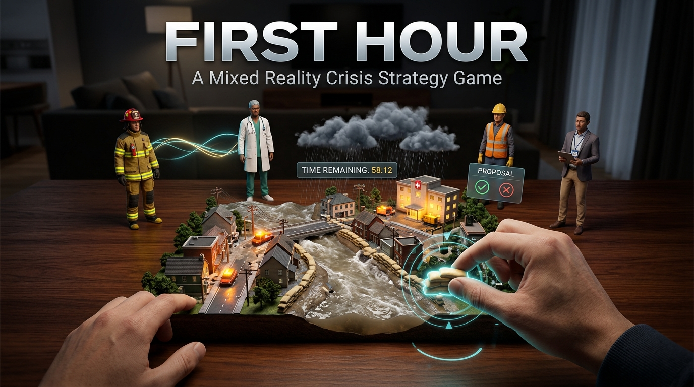

# First Hour — Complete Devpost Submission Package

---

## 1. Quick-Copy Devpost Form Fields

| Field | Value |
|---|---|
| **Project Name** | First Hour |
| **Tagline (131 / 140 chars)** | A flood hits a town on your real table. Four AI department heads argue, whisper and act. You lead with your hands. Ten minutes. |
| **Track** | Gaming |
| **Division** | New Experience |
| **Live Public HTTPS Link** | https://first-hour-phi.vercel.app *(Open in Meta Quest Browser, sit at a table, press **Start**)* |
| **Cover Image / Thumbnail** | `docs/cover.jpg` / `public/cover.jpg` (16:9 HD key art) |
| **Target Launch Date** | Q2 2027 (alongside Meta VR Glasses) |
| **Primary Input Mode** | 100% Hands-Only (Pinch, Grab & Drop, Poke, Head/Gaze Attention, plus optional Hand Microgestures & Push-to-Talk Voice) |
| **Team** | Solo Developer *(Fill in Name, Email, and Role in Devpost)* |

---

## 2. Full Detailed Devpost Project Story (Rich Markdown Version)

*Use this section for the full Devpost project page / detailed write-up. If a specific form field enforces a strict 500-word limit, a condensed ≤500-word version is provided in **Section 3** below.*

### Inspiration

In a real disaster, the life-or-death decisions made in the **first hour** fall to local mayors, hospital directors, school principals, and incident commanders who almost never get to practise them. In emergency management, real practice drills are called **tabletop exercises**: a facilitator gathers people from the fire service, utilities, the hospital, and public information around a map for half a day to argue through a crisis as it unfolds. Because those drills require a trained facilitator and a room full of specialists, most small towns, hospitals, schools, and companies run them rarely or never.

We asked a simple question: **What if those role-players were autonomous AI agents with their own goals, private information, and opinions of you—standing around your own real-world table?**

**First Hour** turns the high-stakes tabletop crisis drill into a ten-minute, seated, hands-only mixed-reality strategy game. And it belongs uniquely in spatial computing: five people arguing at once is unreadable on a flat screen, where everything collapses into a scrolling text log. Around a spatial tabletop:
- **Every department head has a physical place and a spatial voice**, so your ears and eyes naturally separate who is speaking;
- **Where you turn your head *is* your leadership decision** about who gets your scarce attention;
- **Handing someone a physical gold chip *is* delegation**;
- **The town sits on your actual table**, turning your living room or conference room into an emergency operations center.

---

### What It Does

**First Hour** compresses one critical game hour into **10 real minutes** (1 real second = 6 game seconds). When you press **Start**, the game scans your room for a horizontal table or desk using WebXR plane and mesh detection (or conjures a virtual tactical desk if no table is within reach). The riverside town of **Harrow Bend** (a 12×8 grid housing ~1,000 residents, a river with a central bridge, a power substation, a fire station, a 14-bed ICU hospital, and the Hillcrest School shelter on high ground) unfolds on your tabletop like an animated pop-up diorama. Rain begins to fall, floodwaters rise, and four embodied department heads rise along the far edge of the board:

1. **Chief Okafor (Fire Chief):** Impulsive, brave, and blunt. Wants rescue crews in flooded neighborhoods and sandbags along residential riverbanks immediately. Only he sees district-by-district rescue call counts and crew status.
2. **Dr. Lindqvist (Hospital Director):** Cautious, precise, and relentless about patient safety. Protects 14 ICU patients on life support. Only she sees the hospital's backup generator fuel reserves (60 game minutes) and medical grid status.
3. **Ravi Menon (Utilities & Roads Lead):** Methodical and dry; thinks in cascading failure chains. Wants to pre-emptively cut power to flooding districts before water meets live electrical lines, and protect the substation before water hits `0.5m` and triggers a town-wide blackout. Only he sees substation water sensors, bridge stress sensors, and road flood levels.
4. **Mara Quist (Press & Public Officer):** Quick, persuasive, and anxious about public trust. Fights viral social-media misinformation that erodes evacuation compliance. Only she sees the live rumour feed, public compliance rates, and emergency call volume.

#### The Core Loop: Attention, Trust, Whispers, and Trade-Offs
You have two hands, ten minutes, and more problems than resources:
- **Attention is a physical mechanic:** A **20° head-direction cone** (designed to map directly to eye-tracking on Meta VR Glasses) determines which agent has your focus. The agent you face speaks at full volume and displays full captions; unfocused agents drop by `12 dB` and show compact previews.
- **Ignore an agent and they act without you:** Leave a department head unattended for **>45 seconds** without a delegation chip and they **freelance**—deploying tokens on their own judgment. Ignore them for **>60 seconds** and their trust erodes (`-2` every 30s). Drop below **30 trust** and they begin **withholding their private sensor data** from you.
- **Private Whispers & Backroom Deals:** Agents don't just talk to you—they message each other. When two agents communicate privately, a glowing cyan-and-gold **whisper thread** arcs between them for 8 seconds. You can pinch the central bead to eavesdrop and read their message, but **both agents notice you listening (`-5 trust` each)**.
- **Delegation via Gold Chips:** You hold two physical **Gold Authority Chips**. Drop a chip at an agent's feet (`+10 trust`) and their proposals execute automatically without waiting for your approval. Take the chip back (`-8 trust`) to revoke their autonomy.
- **"Agent Minds" X-Ray Lens:** Pinch the glowing **Minds** torus lens on the near-left edge of the board to toggle a live cognitive X-ray over the table—revealing each agent's trust meter (`●●●○○`), whether they are withholding intel, their current intention, their session memory of how you treated them, and color-coded network lines showing who has been messaging whom.

#### The After-Action Debrief & Timeline Scrubbing
When the clock hits 60 game minutes, the board freezes and scores your leadership from **A to E** based on **Residents Safe %**, **Hospital Power Uptime %**, **Rumours Countered**, and **Team Trust**.
Entering the **Debrief** turns the game into an interactive leadership mirror:
- An AI **Debrief Agent** (backed by a deterministic rule analyzer) highlights **three pivotal moments** from your hour, each tied to a real emergency-management principle (*Clear Objectives, Span of Control, Delegation, Checking Information, One Public Message*).
- Pinching any moment—or pinching along the **minute-by-minute timeline scrubber**—**replays the 3D town board** to that exact 10-second snapshot.
- Finally, the debrief reveals **every private whisper you missed** while you were looking elsewhere.

---

### How We Built It

#### 1. Spatial Layer: Meta Immersive Web SDK (IWSDK 1.0) & Procedural Three.js
- Built in TypeScript on **Meta IWSDK 1.0** (`@iwsdk/core`) with WebXR `immersive-ar` passthrough, `handTracking`, `anchors`, `planeDetection`, and `meshDetection`.
- **Zero external 3D model or audio file downloads:** Every mesh (the instanced 12×8 town board, rising water planes, houses, hospital, substation, bridges, agent figures, tokens, whisper arcs, rain particles, and UI cards) is built procedurally at startup, keeping the scene around **~30k triangles** and **~48 visible meshes** for smooth 60–72+ fps Quest performance.
- **Procedural WebAudio Engine (`src/audio/`):** Rain ambience is real-time filtered noise scaled to simulation rainfall intensity; each agent speaks in spatialized procedural syllables with a distinct pitch and formant timbre (or optional Web Speech API synthesis); chimes mark proposals, placements, rejections, and crisis alarms.
- **Smart Table Placement (`src/xr/planes.ts`, `src/xr/table.ts`):** Queries `XRPlane` and bounded `XRMesh` surfaces, prioritizing `table`/`desk` semantic labels within `0.35–1.1m` above the floor whose nearest edge is within `1.2m` of the seated player. Automatically scales the 12:8 board between `0.5×0.35m` and `0.9×0.6m` to fit the real surface, or spawns a fallback virtual desk at `0.45m` reach after 3 seconds.
- **Meta VR Glasses FOV-Ready:** Designed and verified against the `metaVRGlasses` emulator profile (`74° × 68°` field of view). All four agents sit within `±27°` along the far edge, and the token tray occupies the central 70% of the near edge so essential controls never clip outside the narrower optical window.

#### 2. The Deterministic Simulation Engine (`src/sim/`)
The simulation is pure TypeScript with zero DOM or rendering dependencies, stepping in exact `0.5s` real-time increments (`3` game seconds) driven by a seeded Mulberry32 PRNG:
- **Hydrology (`flood.ts`):** River cells accumulate `rain × 0.0013` per game second and equalize water + elevation across orthogonal neighbors. Sandbags raise effective elevation by `+1.0` per stack; the mobile pump drains its cell and neighbors at `0.004/s`.
- **Power & Critical Infrastructure (`power.ts`):** If water at the substation exceeds `0.5`, town-wide grid power drops. Flooded energized cells log live-water electrocution hazards unless Utilities cuts district power. The hospital seamlessly transitions to its 60-minute backup generator and tracks cumulative dark time if fuel runs dry.
- **Population & Evacuation Routing (`people.ts`):** Tracks ~1,000 residents across residential cells. Water `>0.3` places residents in danger; rescue crews stabilize a cell in `120` game seconds; buses pathfind over intact roads and bridges to the high-ground school shelter at `0.2 × compliance / (1 + pathLength / 10)` people per game second.
- **Strict Action Validation (`actions.ts`):** Every action—whether initiated by the player's hands or proposed by an AI agent—passes through `validateAction()` and `applyAction()`, checking coordinates, token availability, terrain rules, and role permissions before mutating state.

#### 3. True 7-Agent Architecture (`src/agents/` & `api/turn.ts`)
Unlike single-prompt "chat wrappers," **First Hour** runs seven isolated agents coordinated by `Orchestrator` (`src/agents/orchestrator.ts`) and a stateless Vercel serverless endpoint (`api/turn.ts`) calling Claude (`claude-haiku-5-5` by default for low latency and ~$0.10/session cost, configurable via `AGENT_MODEL` to `claude-opus-5-5`):
- **Asymmetric Observations (`observe.ts`):** Each department head receives only its own domain telemetry, its personal inbox of whispers and commander orders, its trust score, and its session memory.
- **Structured JSON Schema Enforcement (`prompts.ts`, `types.ts`):** Both the Anthropic API (`output_config.format: json_schema`) and dual client/server **Zod** validators enforce strict output bounds: speech `≤25 words`, rationale `≤15 words`, whispers `≤20 words`, memory notes `≤15 words`, and at most 2 validated action proposals per turn.
- **Behind-the-Scenes Pacing & Analysis:**
  - **Director Agent (`director.ts`):** Monitors crisis tension and triggers up to one crisis event per 60s from a 7-card deck (`bridge_collapse`, `generator_fault`, `bus_stranded`, `rumour_dam`, `rain_surge`, `substation_alarm`, `viral_livestream`).
  - **Rumor Agent (`rumor.ts`):** Generates contextual social-media misinformation every ≥45s that penalizes district evacuation compliance by `0.1 × severity` until countered by a broadcast.
  - **Debrief Agent (`debrief.ts`):** Synthesizes the session log into three actionable leadership critiques.
- **100% Playable Offline / AI-Off ("Remove the Service" Compliance):** Every single agent is backed by a deterministic heuristic policy (`fallback.ts`) and a 288-line situational dialogue bank (`lines.ts` — 4 agents × 6 situations × 12 lines). If you toggle **"AI agents on"** off on the landing page, play offline, hit the 8-second timeout, or reach the 250-call session cap, the game plays seamlessly from start to debrief without a single hiccup.

#### 4. Replayability, Persistence & Daily Challenge (`src/game/`)
- **Campaign Progression (`persist.ts`, `progress.ts`):** Saves progress in `localStorage` with zero sign-up friction. Earning an **A** or **B** rating unlocks persistent town upgrades across runs (**1. Riverside Levee**, **2. 90-Min Backup Hospital Generator**, **3. Third Evacuation Bus**), rotates weather conditions (*Heavy Rain → Night Storm → Light Rain*), and carries up to **3 cross-session agent memory notes** into your next drill (*"You left me hanging last time"*).
- **Daily Challenge Mode (`daily.ts`):** Hashes the local calendar date (`FNV-1a`) into a shared daily seed so every player and judge on the same day faces the exact same storm curve and tracks their daily personal best.

---

### Hand Interactions & Multimodal Accessibility

**First Hour** is built from the ground up to be **100% controller-free**. Every interaction sits within a comfortable `0.3–0.7m` (two-foot) seated reach:

| Interaction | Gesture / Modality | Spatial Feedback & Game Effect |
|---|---|---|
| **Deploy / Recall Resources** | **Pinch-grab & release** tokens from the near-edge tray (`Sandbags ×4`, `Crews ×2`, `Buses ×2`, `Pump ×1`, `Fuel Truck ×1`) | Hovering highlights valid board cells in green/red; invalid drops (e.g., a bus in the river) chime and glide smoothly back to the tray. Releasing off-board recalls the token. |
| **Request Sitrep** | **Pinch or fingertip-poke** an agent's gold **Badge** | Immediately wakes that agent to deliver a domain report (or withhold it if trust `<30`). |
| **Approve / Deny Proposal** | **Pinch or poke** `✓` or `✗` on the floating card above an agent | Executes the action (`+5 trust`) or rejects it (`-3 trust`). Unanswered cards expire after 15s. |
| **Eavesdrop on Whispers** | **Pinch** the glowing bead at the apex of a **Whisper Thread** | Reveals the private message between two agents; both notice (`-5 trust` each). |
| **Delegate Authority** | **Pinch-grab** a **Gold Chip** and drop it at an agent's feet | Grants autonomous execution (`+10 trust`); picking the chip back up revokes it (`-8 trust`). |
| **Issue Public Broadcast** | **Pinch** the purple **Broadcast** card, then pinch 1 of 3 drafts | Boosts town-wide compliance (`+0.15`) and counters active rumours (`+0.20` in target district). 30s cooldown. |
| **Inspect Agent Minds** | **Pinch or poke** the cyan **Minds** torus lens | Toggles the X-ray cognitive overlay (trust bars, withheld intel flags, memories, and whisper network links). |
| **Direct Attention** | **Natural head turn / gaze** (20° cone) | Highlights the focused agent, expands their captions, raises their voice, and prevents neglect decay. |
| **Hand Microgestures** | **Thumb-to-index tap / swipe** (Quest hand microgestures) | Tap = approve focused proposal; Swipe left = deny; Swipe forward = request status report. |
| **Optional Voice Commands** | **Pinch-to-Talk Mic** on the table (`SpeechRecognition`) | Speak natural orders (*"Approve Fire Chief"*, *"Ravi, status report"*, *"Chief, send crews to Riverside"*, *"Pause"*). Every voice command has a 1:1 hand equivalent. |
| **Pause & Comfort** | **Poke** the **Pause Dial** (or remove headset / open menu) | Freezes simulation, audio, and agent timers; increments `session.epoch` so in-flight AI replies from before the pause are safely discarded. |

---

### Challenges We Ran Into

1. **Keeping Asynchronous LLMs Honest Against a Real-Time Clock:** An AI agent takes 1–5 seconds to reply, during which floodwaters move, bridges collapse, or the player might pause the game or move a token themselves. We solved this with **two-stage validation and epoch tagging**: every pause increments `session.epoch` (dropping stale replies), and every agent proposal is validated against the simulation *when it arrives* and *again at the moment the player pinches `✓`* (returning stale proposals to the agent's inbox so it can adapt).
2. **Preventing "Wall-of-Text" Fatigue in XR:** Reading paragraphs in passthrough kills presence and overflows the narrower Meta VR Glasses field of view. We enforced hard word caps at both the schema and prompt levels (`≤25 words` for speech, rendered on single-line high-contrast canvas billboards), shifted relationship state into the visual **Agent Minds** X-ray lens, and made **head direction** automatically collapse unfocused captions.
3. **Fitting Five Competing Voices Into One Seated Table:** When four agents want your attention at once, flat audio becomes chaos. By synthesizing distinct procedural voice formants in 3D space and attenuating unfocused agents by `12 dB`, simply turning your head toward Dr. Lindqvist or Chief Okafor naturally filters the room.
4. **Developing and Verifying Without Physical Hardware Access:** Because development relied on the IWSDK browser emulator (**IWER** + `@iwer/sem`), we built **144 automated unit and integration tests across 21 test suites** covering every simulation rule, orchestrator edge case, table-finding geometry calculation, and voice parser rule—plus a development `×8` fast-forward mode (`KeyF`) and automated CLI hand-sequence scripts (`npx @iwsdk/cli xr run-sequence`) to verify full 10-minute sessions end to end.

---

### Accomplishments We're Proud Of

- **Genuinely Agentic Gameplay—Not a Chatbot Wrapper:** Agents have partial observability, private inboxes, trust thresholds, autonomous freelancing when ignored, and backchannel whispers—yet every action is strictly governed by a deterministic simulation.
- **Passes the "Remove the AI" Test 100%:** Toggle AI off on the landing page (or unplug the network) and **First Hour** remains a rich, replayable strategy game powered by heuristic policies and 288 pre-written situational lines.
- **Zero-Asset-Download Instant Load:** The entire 3D town, characters, particle effects, and spatial audio engine are procedurally generated in TypeScript—loading almost instantly in the Meta Quest Browser over HTTPS with ~30k triangles.
- **144 Passing Tests Across 21 Suites:** Complete deterministic test coverage of flood physics, electrical cascading failures, evacuation pathfinding, table geometry selection, schema validation, and multi-agent orchestration.

---

### What's Next for First Hour

- **Multiplayer Human + AI Tabletop Drills:** Allow 2–4 real colleagues in co-located or remote headsets to take seats around the same table, with AI agents filling the remaining departments.
- **New Crisis Cartridges:** Wildfire evacuation, urban heatwave & grid brownout, hospital mass-casualty surge, and municipal water-plant cyberattack.
- **Hardware Eye-Tracking on Meta VR Glasses:** Bind `src/game/attention.ts` directly to WebXR eye-gaze rays so glancing at an agent or awhisper thread focuses them effortlessly.
- **Bring Your Own Town (GIS Import):** Generate the board from OpenStreetMap elevation and building footprints so real city councils, schools, and hospitals can drill on their own streets.
- **Enterprise "Drill Mode":** Facilitator scenario injection,certified FEMA/ICS after-action report exports (PDF/JSON), and institutional training dashboards.

---

## 3. Condensed Description (≤500 Words Version)

*Use this version if the Devpost submission form enforces a strict 500-word limit on the main description field (468 words):*

**Inspiration**
In a disaster, first-hour decisions fall to local officials who rarely practise them. Real "tabletop exercises" need a trained facilitator and a room of role-players from fire, medical, utilities, and press—so most towns, schools, and hospitals seldom run them. What if those role-players were autonomous AI agents with their own goals, secrets, and opinions of you, standing around your own real table?

**What it is**
**First Hour** is a seated, hands-only mixed-reality strategy game for Meta Quest and Meta VR Glasses. A miniature riverside town (**Harrow Bend**) unfolds on your detected real-world table as a flash flood begins. Four AI department heads stand along its far edge:
- **Chief Okafor (Fire):** wants rescue crews and sandbags on flooded homes now;
- **Dr. Lindqvist (Hospital):** fights to keep power and generator fuel for 14 ICU patients;
- **Ravi Menon (Utilities):** wants to cut district power before floodwater meets live lines and protect the substation;
- **Mara Quist (Press):** battles viral social-media rumours that stall evacuations.

They propose actions, argue, and whisper privately to each other. You have one game hour (10 real minutes) and two hands.

**How you play (100% hands-only)**
Everything sits within a seated 2-foot reach:
- **Pinch-grab and drop** sandbags, rescue crews, evacuation buses, a mobile pump, and a fuel truck from your tray onto the 3D town map.
- **Pinch `✓` or `✗`** on floating proposal cards, or **pinch an agent's badge** for a sitrep.
- **Pinch a glowing whisper thread** arcing between two agents to eavesdrop on backroom deals (they notice, costing `-5` trust each).
- **Hand a physical Gold Chip** to an agent to delegate automatic authority (`+10` trust).
- **Pinch the Minds X-ray lens** to inspect agent trust, memories, withheld intel, and whisper networks, or **pinch the Broadcast card** to counter panic.
- **Attention is the core resource:** A 20° head/gaze cone determines who you hear clearly. Agents you ignore lose trust, start freelancing on their own, and withhold private sensor data.

After 10 minutes, an interactive **Debrief** grades your leadership (A–E), highlights three pivotal moments against crisis-management principles, lets you **scrub the 3D board through time**, and reveals the whispers you missed.

**How we built it**
Built with **Meta's Immersive Web SDK 1.0** (Three.js + ECS) and deployed on **Vercel**. All 3D geometry (~30k triangles) and spatial audio are 100% procedural with zero asset downloads. A deterministic TypeScript simulation models hydrology, grid blackouts, generator fuel, and bus pathfinding, verified by **144 unit tests across 21 suites**. Seven specialized Claude agents (4 department heads + Director, Rumor, and Debrief agents) operate with asymmetric observations and Zod-validated JSON schemas—backed by complete rule-based policies so the game plays 100% offline or with AI toggled off.

**What's next**
Multiplayer human/AI co-drills, wildfire and cyberattack scenarios, eye-tracking on Meta VR Glasses, and custom town maps for real emergency-management training.

---

## 4. Demo Video Production Guide & Shot List (< 3 Minutes, Real Footage Only)

*Competition Rule Reminder: Video must be under 3 minutes, hosted on YouTube or Vimeo, and show **100% real captured footage** from the running build (no AI-generated video).*

### Recording Setup
- **Capture Tool:** OBS Studio at `1920×1080`, 60 fps, desktop audio enabled.
- **Environment:** IWSDK Emulator (`conference_room` in `iwsdk.config.json`) with `hand` input mode active.
- **Camera Pose:** Seated at the conference table (`y ≈ 1.2`, `z ≈ -0.7`).
- **Options on Landing Page:** Keep `AI agents on`, `Spoken agent voices` (or `babble`), and `Voice commands` checked so the mic and X-ray lens are visible on the table.

### Shot-by-Shot Script (`2:50` Total Runtime)

| Timestamp | Visual Shot (What to Show on Screen) | Caption / Voiceover Overlay |
|---|---|---|
| **0:00 – 0:12** | **Landing Page & Unfold:** Show the landing page with options (`AI agents on`, `Spoken voices`, `Daily challenge`). Click **Start**. The camera enters passthrough at the conference table; **Harrow Bend** unfolds like a pop-up book as rain particles begin falling and the 4 department heads rise along the far edge. | *"In a disaster, the first hour decides everything. Most officials never get to practise it. In First Hour, a crisis unfolds on your real table."* |
| **0:12 – 0:38** | **Asymmetric Agents & Attention Mechanic:** Turn your head from left to right across **Chief Okafor**, **Dr. Lindqvist**, **Ravi Menon**, and **Mara Quist**. Show how the focused agent's caption expands and voice rises while others murmur. Pinch Chief Okafor's gold **Badge** to request a report. | *"Four autonomous AI department heads stand around your table. Each sees different data, has their own goals, and reacts to where you look."* |
| **0:38 – 1:15** | **Hands-Only Tactical Play:** Pinch-grab a **Sandbag** token from the near tray, hover over the flooded Riverside bank (green cell highlight), and drop it. Pinch `✓` on Chief Okafor's proposal card to deploy a rescue crew (`+5 trust`). Grab a **Gold Chip** and drop it at Ravi Menon's feet (`+10 trust`) to delegate power-grid authority. | *"Every action is a pinch within a two-foot seated reach: place sandbags and rescue crews, approve proposals, or hand a physical gold chip to delegate authority."* |
| **1:15 – 1:45** | **Whispers & The "Agent Minds" X-Ray Lens:** A glowing cyan **whisper thread** arcs between Utilities and Hospital. Pinch its center bead to eavesdrop—the secret message appears and both agents lose trust. Then pinch the **Minds** torus lens on the left edge of the table to reveal the cognitive X-ray overlay (trust bars, memories, and inter-agent links). | *"Agents talk behind your back. Pinch a whisper thread to eavesdrop—at the cost of their trust—or toggle the Agent Minds X-ray lens to see what they're thinking and withholding."* |
| **1:45 – 2:15** | **Crisis Escalation, Broadcasts & Voice Command:** The **Director Agent** triggers a red banner (`⚠ BRIDGE COLLAPSED` or `📣 RUMOUR SPREADING: "the dam burst"`). Pulsing red danger cells light up on the board. Pinch the purple **Broadcast** card and select the counter-message to restore public compliance. Optionally pinch the tabletop **Mic** to issue a spoken order. | *"Behind the scenes, a Director agent triggers cascading failures and a Rumor agent spreads panic. Counter misinformation with public broadcasts or optional push-to-talk voice orders."* |
| **2:15 – 2:40** | **Outcome & Interactive 3D Debrief Replay:** The clock reaches `60:00` ("The first hour is over"). Show the **Outcome Card** (People Safe %, Hospital Uptime %, Rumours Countered, Letter Rating). Pinch **Debrief**: pinch through the 3 leadership moments and scrub the timeline markers (`10m`, `30m`, `50m`) as the 3D board replays the flood state and reveals missed whispers. | *"When the hour ends, an AI Debrief reviews your leadership, reveals the backroom deals you missed, and lets you scrub the 3D tabletop through time."* |
| **2:40 – 2:50** | **Closing Card & Replayability:** Show the unlocked upgrade (`Levee` / `Backup Generator`), Daily Challenge seed, and the Meta VR Glasses narrow-FOV preview (`metaVRGlasses`). | *"First Hour — Built with Meta IWSDK 1.0 for Meta Quest & Meta VR Glasses. Playable now in the browser."* |

---

## 5. Judge's Quick-Verification Checklist

| Judging Criterion (25% Each) | How to Verify in `First Hour` |
|---|---|
| **1. Innovation** | Observe the 7-agent architecture in action: turn your head to shift attention, watch agents whisper via glowing 3D threads, drop a gold delegation chip, toggle the **Minds** X-ray lens, and inspect the timeline-scrubbing 3D Debrief. |
| **2. Experience Design** | Play seated using only hands. Notice the zero-text-wall onboarding taught naturally by the agents in the first 90 seconds, the tactile token tray within a 2-foot radius, and the complete 10-minute session arc. |
| **3. Technical Implementation** | Toggle **"AI agents on"** off on the landing page to verify the complete offline rule-based fallback; inspect the procedural 30k-triangle board, WebXR table detection, and 144 automated Vitest tests (`npm test`). |
| **4. Polish** | Check the rain particle system, pulsing danger cells, spatial WebAudio babble + spoken voices, High Contrast accessibility toggle, Daily Challenge mode, and persistent cross-session upgrades and agent memories. |
